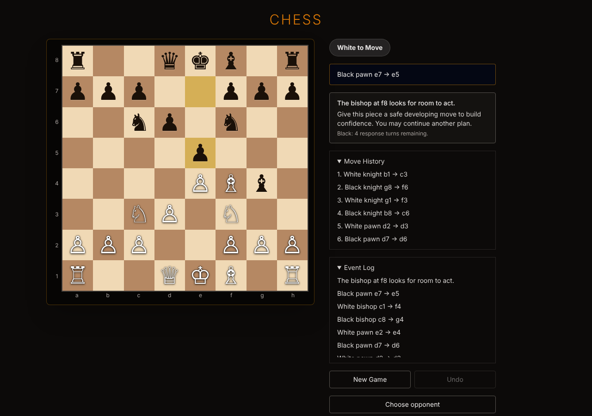
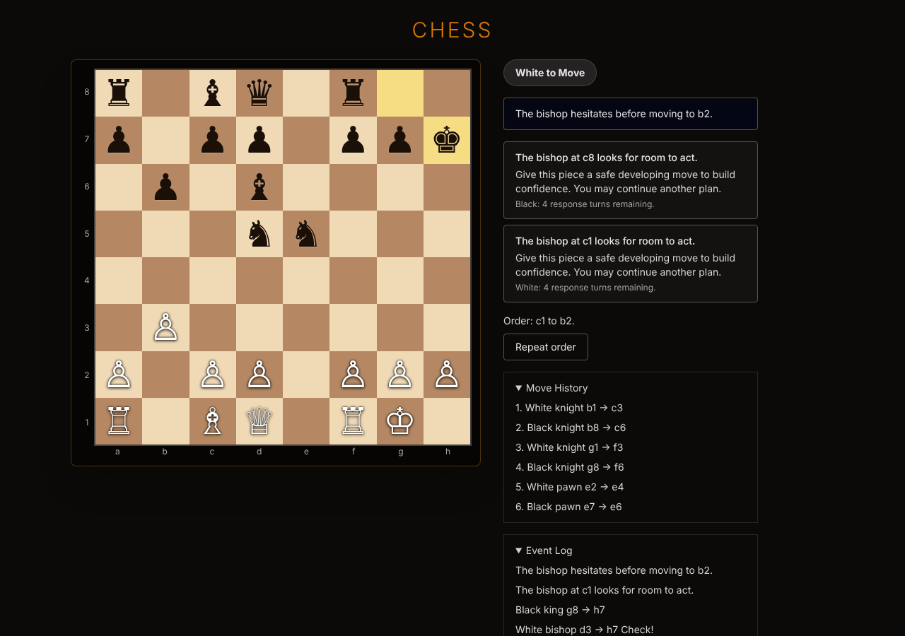

# Playtest report: how often the RPG mechanic is encountered

Rules `2026-09-23.1` (Hidden Kingdom generation 6, the default for new games).
Measured on 2026-11-10 over 1,380 seeded games against the computer (100,748
plies), plus 34 games played through the browser UI.

## Summary

- **The RPG layer is on screen for about 70% of a game.** Across all games,
  something from it is visible after 71% of plies. By cell the figure runs
  from 62% to 79%.
- **It starts at ply 10, in effectively every game.** Plies 1–8 are a
  guaranteed quiet opening. The first request card appears at ply 10 (median;
  90% of games by ply 12). From then on it is visible after 81–87% of plies in
  eight of the nine cells.
- **Request cards are almost all of it.** A card is showing after 60–78% of
  plies. A new card appears every 3 plies or so (median), which is 3–14 cards
  per side per game depending on game length.
- **A piece refuses the player's order about once in 40 orders (2.5%).** That
  works out to 0.6–1.5 hesitations per game. Between 40% and 68% of games
  contain at least one, and 8–40% contain two or more. This is the only part
  of the mechanic that interrupts the player.
- **Everything else is rare.** A piece moves somewhere other than ordered
  (withdrawal or overrun) in 1–16% of games. A conspiracy forms in 0–4% of
  games. No conspiracy ever reached an attempt on the king: 0 regicides in
  1,380 games.
- **Play style changes the mix more than opponent strength does.** Reckless
  play gets more hesitations and withdrawals. Long, even games get many more
  cards. Easy, Normal and Advanced opponents give similar coverage.

## What counts as "encountering" the mechanic

The player meets the hidden politics in six ways. The report uses the game's
own definition (`presence()` in `lib/rpg/presence.ts`): a ply counts if any of
these is true right after it.

| Channel      | What the player sees                                                         | Interrupts play?            |
| ------------ | ---------------------------------------------------------------------------- | --------------------------- |
| Request card | A "Piece requests" card for either side, with a response hint and a deadline | No                          |
| Log line     | A new RPG line in the Event Log (request raised or resolved, shaken warning) | No                          |
| Hesitation   | "The … hesitates"; the order is not carried out and "Repeat order" appears   | Yes, when it is your piece  |
| Unexpected   | A piece ends on a different square than ordered (withdrawal or overrun)      | No, but it changes the move |
| Warning      | A standing conspiracy warning with a marked square                           | No                          |
| Ambient      | A flavour line on an otherwise silent ply                                    | No                          |

Two measures appear below:

- **On screen**: any channel is showing after the ply, including a card that
  was raised earlier and is still open.
- **Something new**: a hesitation, an unexpected move or a new log line
  happened on that ply.

## Method

- **Headless games.** `scripts/playtest-frequency.ts` replays the same games
  as the existing `npm run playtest` harness (same seeds, same player styles,
  same computer opponent) and records every ply.
- **Player styles (White).**
  - `aware` reads the request cards and prefers safe moves that answer them.
  - `engine` is a Normal-strength search.
  - `reckless` favours moves that put its own pieces in danger.
  - All three repeat a hesitated order half the time.
- **Opponent (Black).** The real computer opponent at Easy, Normal and
  Advanced.
- **Sample.** 200 games per cell for Easy and Normal (seeds 7000–7199), and
  60 per cell for Advanced (seeds 7000–7059, because each Advanced game takes
  about 12 s). Games are capped at 200 plies.
- **Browser games.** `scripts/playtest-browser.ts` plays "Play computer"
  games by clicking squares in the production build, and counts what is on
  screen at each of the player's turns.

Commands:

```bash
npx tsx scripts/playtest-frequency.ts --style aware,engine,reckless --difficulty normal --games 200
```

```bash
npm run build && npx next start -p 3100
```

```bash
npx tsx scripts/playtest-browser.ts --games 18
```

## Results

### Coverage: how much of a game has RPG content on screen

| Opponent | Style    | Games | W/D/L     | Median plies | On screen | On screen at the player's turn | Something new | From ply 9 on |
| -------- | -------- | ----- | --------- | ------------ | --------- | ------------------------------ | ------------- | ------------- |
| Easy     | aware    | 200   | 14/133/53 | 119          | 62%       | 63%                            | 32%           | 66%           |
| Easy     | engine   | 200   | 200/0/0   | 49           | 73%       | 76%                            | 40%           | 86%           |
| Easy     | reckless | 200   | 0/9/191   | 62           | 77%       | 78%                            | 36%           | 87%           |
| Normal   | aware    | 200   | 0/0/200   | 50           | 68%       | 70%                            | 42%           | 81%           |
| Normal   | engine   | 200   | 95/36/69  | 103          | 78%       | 83%                            | 48%           | 85%           |
| Normal   | reckless | 200   | 0/0/200   | 50           | 68%       | 68%                            | 39%           | 82%           |
| Advanced | aware    | 60    | 0/0/60    | 40           | 67%       | 68%                            | 43%           | 83%           |
| Advanced | engine   | 60    | 2/3/55    | 80           | 79%       | 81%                            | 45%           | 87%           |
| Advanced | reckless | 60    | 0/0/60    | 36           | 68%       | 69%                            | 38%           | 87%           |

Percentages are shares of plies. Pooled over all 100,748 plies: on screen 71%,
something new 40%.

Game-to-game spread of the "on screen" share:

| Opponent | Style    | Lowest game | 10th percentile | Median | 90th percentile | Highest game |
| -------- | -------- | ----------- | --------------- | ------ | --------------- | ------------ |
| Easy     | aware    | 26%         | 43%             | 67%    | 79%             | 89%          |
| Easy     | engine   | 31%         | 58%             | 73%    | 81%             | 85%          |
| Easy     | reckless | 0%          | 44%             | 75%    | 86%             | 93%          |
| Normal   | aware    | 45%         | 56%             | 68%    | 76%             | 83%          |
| Normal   | engine   | 56%         | 61%             | 78%    | 86%             | 94%          |
| Normal   | reckless | 46%         | 59%             | 69%    | 76%             | 83%          |
| Advanced | aware    | 42%         | 53%             | 68%    | 75%             | 79%          |
| Advanced | engine   | 54%         | 68%             | 78%    | 85%             | 89%          |
| Advanced | reckless | 36%         | 50%             | 67%    | 76%             | 83%          |

The 0% games are in Easy/reckless only: 7 of 200 games (4%) ended before ply
10, so the mechanic never had a chance to appear. Every other game in the
sample showed it at least once.

### Channels: what is on screen

Share of plies after which each channel is showing.

| Opponent | Style    | Request card | New log line | Hesitation | Unexpected move | Warning | Ambient line |
| -------- | -------- | ------------ | ------------ | ---------- | --------------- | ------- | ------------ |
| Easy     | aware    | 60.5%        | 31.8%        | 2.1%       | 0.1%            | 0.0%    | 0.9%         |
| Easy     | engine   | 71.6%        | 40.2%        | 2.3%       | 0.1%            | 0.0%    | 1.6%         |
| Easy     | reckless | 75.9%        | 36.3%        | 2.6%       | 0.2%            | 0.1%    | 1.3%         |
| Normal   | aware    | 66.3%        | 42.4%        | 2.2%       | 0.0%            | 0.3%    | 1.2%         |
| Normal   | engine   | 78.1%        | 47.5%        | 2.2%       | 0.0%            | 0.0%    | 0.8%         |
| Normal   | reckless | 67.1%        | 38.5%        | 2.8%       | 0.3%            | 0.1%    | 1.5%         |
| Advanced | aware    | 64.8%        | 42.7%        | 2.6%       | 0.0%            | 0.0%    | 1.9%         |
| Advanced | engine   | 77.4%        | 45.1%        | 2.3%       | 0.0%            | 0.2%    | 1.6%         |
| Advanced | reckless | 66.5%        | 38.2%        | 2.7%       | 0.2%            | 0.1%    | 1.6%         |

Request cards carry the coverage. Removing ambient lines changes the "on
screen" share by about one point at most.

### Counts per game

Mean per game.

| Opponent | Style    | Plies with something new | Player's requests | Computer's requests | Requests fulfilled | Requests expired | Player hesitations | Computer hesitations | Shaken warnings | Ambient lines |
| -------- | -------- | ------------------------ | ----------------- | ------------------- | ------------------ | ---------------- | ------------------ | -------------------- | --------------- | ------------- |
| Easy     | aware    | 39.0                     | 10.2              | 9.2                 | 12.2               | 2.3              | 1.52               | 1.02                 | 5.5             | 1.1           |
| Easy     | engine   | 20.2                     | 5.3               | 5.0                 | 5.5                | 1.4              | 0.56               | 0.58                 | 4.0             | 0.8           |
| Easy     | reckless | 26.2                     | 4.0               | 8.7                 | 5.5                | 2.9              | 0.94               | 0.91                 | 6.7             | 0.9           |
| Normal   | aware    | 22.1                     | 5.2               | 5.6                 | 7.3                | 0.8              | 0.69               | 0.48                 | 3.9             | 0.6           |
| Normal   | engine   | 52.0                     | 13.7              | 14.0                | 19.5               | 2.7              | 1.27               | 1.14                 | 1.8             | 0.8           |
| Normal   | reckless | 19.1                     | 3.9               | 5.3                 | 3.9                | 1.9              | 0.81               | 0.60                 | 5.1             | 0.7           |
| Advanced | aware    | 17.7                     | 4.2               | 4.2                 | 4.5                | 0.9              | 0.60               | 0.48                 | 5.4             | 0.8           |
| Advanced | engine   | 37.6                     | 9.3               | 10.1                | 12.5               | 2.2              | 0.92               | 0.98                 | 4.2             | 1.3           |
| Advanced | reckless | 13.9                     | 3.1               | 3.5                 | 2.0                | 1.7              | 0.55               | 0.45                 | 4.8             | 0.6           |

Of the 20,053 requests raised in the sample, 60% were fulfilled, 13% expired
unanswered and 27% were interrupted before either could happen. The careful style fulfils far more of its requests than the
reckless style.

Request types, as a share of all requests raised: initiative 34%, petition
24%, solidarity 14%, protection 10%, confidence 8%, strain 5%, relief 4%,
complaint 1%, dispute about 0.1%.

### Share of games in which each thing happens at least once

| Opponent | Style    | Request card | Any hesitation | Player hesitation | Two or more player hesitations | Shaken warning | Ambient line | Withdrawal | Overrun | Court complaint | Conspiracy | Regicide |
| -------- | -------- | ------------ | -------------- | ----------------- | ------------------------------ | -------------- | ------------ | ---------- | ------- | --------------- | ---------- | -------- |
| Easy     | aware    | 100%         | 88%            | 68%               | 40%                            | 98%            | 71%          | 8%         | 2%      | 23%             | 1%         | 0%       |
| Easy     | engine   | 100%         | 66%            | 40%               | 12%                            | 95%            | 56%          | 3%         | 2%      | 15%             | 1%         | 0%       |
| Easy     | reckless | 96%          | 78%            | 60%               | 26%                            | 94%            | 62%          | 12%        | 2%      | 28%             | 4%         | 0%       |
| Normal   | aware    | 100%         | 70%            | 52%               | 14%                            | 97%            | 47%          | 0%         | 0%      | 20%             | 4%         | 0%       |
| Normal   | engine   | 100%         | 90%            | 66%               | 33%                            | 61%            | 56%          | 0%         | 1%      | 2%              | 0%         | 0%       |
| Normal   | reckless | 100%         | 74%            | 54%               | 20%                            | 98%            | 52%          | 16%        | 0%      | 24%             | 2%         | 0%       |
| Advanced | aware    | 100%         | 63%            | 42%               | 15%                            | 97%            | 53%          | 2%         | 0%      | 25%             | 0%         | 0%       |
| Advanced | engine   | 100%         | 83%            | 58%               | 18%                            | 98%            | 72%          | 0%         | 3%      | 22%             | 2%         | 0%       |
| Advanced | reckless | 100%         | 60%            | 43%               | 8%                             | 100%           | 48%          | 8%         | 0%      | 20%             | 2%         | 0%       |

### Interruptions: how often a piece refuses the player

A hesitation on the player's own piece is the only RPG event that demands
input. The player either repeats the order or picks another move.

| Opponent | Style    | Player orders | Refused | Rate | About 1 in | Computer's rate | Median plies between two player hesitations |
| -------- | -------- | ------------- | ------- | ---- | ---------- | --------------- | ------------------------------------------- |
| Easy     | aware    | 12,568        | 304     | 2.4% | 42         | 1.7%            | 16                                          |
| Easy     | engine   | 5,235         | 111     | 2.1% | 48         | 2.3%            | 18                                          |
| Easy     | reckless | 7,392         | 189     | 2.6% | 38         | 2.5%            | 8                                           |
| Normal   | aware    | 5,333         | 137     | 2.6% | 38         | 1.8%            | 10                                          |
| Normal   | engine   | 11,246        | 255     | 2.3% | 43         | 2.1%            | 18                                          |
| Normal   | reckless | 5,114         | 161     | 3.1% | 32         | 2.4%            | 8                                           |
| Advanced | aware    | 1,276         | 36      | 2.8% | 36         | 2.3%            | 12                                          |
| Advanced | engine   | 2,557         | 55      | 2.2% | 45         | 2.3%            | 12                                          |
| Advanced | reckless | 1,125         | 33      | 2.9% | 34         | 2.4%            | 10                                          |

Pooled: 1,281 refusals in 51,846 player orders, 2.5%. The rate is stable
across opponents. Hesitations per game therefore track game length: the long
Easy/aware games (median 119 plies) see 1.5 per game, and the short Advanced
games see 0.6. The last column covers only games with two or more player
hesitations.

### Timing: when it first appears

Median ply of first occurrence, with the 10th–90th percentile range, over the
games in which it occurs.

| Opponent | Style    | Anything   | Player's first request | First hesitation (either side) | Player's first hesitation | First ambient line | First unexpected move |
| -------- | -------- | ---------- | ---------------------- | ------------------------------ | ------------------------- | ------------------ | --------------------- |
| Easy     | aware    | 10 (10–12) | 11 (11–13)             | 26 (12–65)                     | 39 (13–83)                | 22 (12–49)         | 80 (36–137)           |
| Easy     | engine   | 10 (10–10) | 11 (10–13)             | 23 (12–47)                     | 27 (13–49)                | 23 (14–40)         | 36 (22–63)            |
| Easy     | reckless | 10 (10–12) | 11 (10–13)             | 20 (11–39)                     | 23 (13–39)                | 19 (9–35)          | 35 (23–54)            |
| Normal   | aware    | 10 (10–10) | 11 (10–11)             | 23 (13–48)                     | 25 (13–43)                | 25 (16–46)         | 52 (2 games)          |
| Normal   | engine   | 10 (10–10) | 11 (11–11)             | 31 (13–71)                     | 41 (17–87)                | 78 (40–117)        | 194 (2 games)         |
| Normal   | reckless | 10 (10–12) | 11 (10–13)             | 19 (11–37)                     | 19 (11–35)                | 19 (11–35)         | 31 (19–39)            |
| Advanced | aware    | 10 (10–11) | 11 (10–12)             | 24 (10–37)                     | 27 (15–43)                | 25 (14–43)         | 59 (1 game)           |
| Advanced | engine   | 10 (10–10) | 11 (11–12)             | 35 (13–59)                     | 35 (13–61)                | 31 (16–64)         | 160 (2 games)         |
| Advanced | reckless | 10 (10–12) | 11 (10–12)             | 19 (10–34)                     | 19 (13–37)                | 19 (9–38)          | 27 (19–39)            |

Conspiracy warnings, when they occur at all, first appear between ply 41 and
ply 55. The rules do not allow a plot before ply 40.

### Timing: by stage of the game

Share of plies with RPG content on screen, by ply range. The number of games
that reached each range is in brackets.

| Opponent | Style    | Plies 1–8 | 9–16      | 17–32     | 33–48     | 49–64     | 65+       |
| -------- | -------- | --------- | --------- | --------- | --------- | --------- | --------- |
| Easy     | aware    | 0% (200)  | 80% (200) | 88% (199) | 85% (194) | 78% (185) | 52% (177) |
| Easy     | engine   | 0% (200)  | 80% (200) | 90% (198) | 88% (174) | 84% (105) | 80% (39)  |
| Easy     | reckless | 0% (200)  | 80% (196) | 92% (179) | 87% (156) | 82% (128) | 88% (92)  |
| Normal   | aware    | 0% (200)  | 75% (200) | 83% (200) | 84% (187) | 75% (114) | 77% (38)  |
| Normal   | engine   | 0% (200)  | 67% (200) | 75% (200) | 74% (200) | 84% (199) | 95% (165) |
| Normal   | reckless | 0% (200)  | 80% (200) | 94% (200) | 80% (171) | 56% (103) | 73% (28)  |
| Advanced | aware    | 0% (60)   | 80% (60)  | 85% (60)  | 86% (42)  | 80% (17)  | 75% (3)   |
| Advanced | engine   | 0% (60)   | 68% (60)  | 86% (60)  | 90% (59)  | 89% (53)  | 91% (37)  |
| Advanced | reckless | 0% (60)   | 77% (60)  | 95% (60)  | 86% (38)  | 66% (10)  | none      |

Two soft spots show up:

- **Easy/aware after ply 65: 52%.** These are long endgames with few pieces
  left (most of this cell's games end in a draw by insufficient material,
  stalemate or the ply cap). The longest stretch with nothing on screen
  reaches 48 plies in the worst 10% of these games.
- **Reckless against Normal, plies 49–64: 56%.** The reckless side has lost
  most of its pieces by then.

Hesitations show after 2–4% of plies from ply 9 to ply 48, and after about 2%
or less from ply 65 on.

### Timing: gaps

| Opponent | Style    | Plies between new events (median, 10th–90th) | Plies between new request cards | Longest stretch with nothing on screen after ply 10 (median, 10th–90th) |
| -------- | -------- | -------------------------------------------- | ------------------------------- | ----------------------------------------------------------------------- |
| Easy     | aware    | 2 (1–5)                                      | 6 (1–8)                         | 8 (3–48)                                                                |
| Easy     | engine   | 1 (1–4)                                      | 3 (1–7)                         | 3 (0–4)                                                                 |
| Easy     | reckless | 2 (1–5)                                      | 6 (1–8)                         | 3 (0–5)                                                                 |
| Normal   | aware    | 1 (1–4)                                      | 3 (1–7)                         | 3 (1–5)                                                                 |
| Normal   | engine   | 1 (1–5)                                      | 3 (1–7)                         | 3 (3–3)                                                                 |
| Normal   | reckless | 1 (1–4)                                      | 5 (1–8)                         | 3 (0–5)                                                                 |
| Advanced | aware    | 1 (1–4)                                      | 2 (1–7)                         | 3 (1–4)                                                                 |
| Advanced | engine   | 1 (1–4)                                      | 3 (1–7)                         | 3 (2–4)                                                                 |
| Advanced | reckless | 1 (1–4)                                      | 3 (1–7)                         | 1 (0–4)                                                                 |

Once the opening is over, the screen is rarely empty of RPG content for more
than 3 plies in a row, except in the long Easy/aware endgames.

### Rare events

Totals over all 1,380 games.

| Event                                      | Count | Per game | Notes                                         |
| ------------------------------------------ | ----- | -------- | --------------------------------------------- |
| Withdrawal (piece retreats instead)        | 86    | 0.06     | 62 of them in the reckless cells              |
| Overrun (piece goes one square further)    | 18    | 0.013    | Limited to one per side per game by the rules |
| Court complaint raised                     | 279   | 0.20     | In 2–28% of games depending on the cell       |
| Complaint renewed with a warning           | 90    | 0.07     |                                               |
| Conspiracy formed                          | 25    | 0.018    | In 0–4% of games                              |
| Conspiracy reaching an attempt on the king | 0     | 0        | Every plot broke up or the game ended first   |
| Regicide (game ended by the plot)          | 0     | 0        |                                               |

The conspiracy and regicide endgame is effectively never seen in ordinary
play. A player would need roughly 50 games to see one conspiracy warning, and
the sample contains no attempt at all.

## Browser cross-check

The headless numbers come from the rules engine alone, so 34 further games
were played through the real UI in headless Chromium, by clicking squares
against the computer.





### What was on screen (20 games)

At each of the player's 883 turns the script read the page and compared it
with the saved game.

| Opponent | Games | Player turns | Turns with RPG content on screen | Headless figure (aware style) |
| -------- | ----- | ------------ | -------------------------------- | ----------------------------- |
| Easy     | 8     | 521          | 64%                              | 63%                           |
| Normal   | 6     | 207          | 67%                              | 70%                           |
| Advanced | 6     | 155          | 70%                              | 68%                           |

- **The page matched the saved state on all 883 turns**: the number of
  request cards, whether "Repeat order" was showing, and whether a warning
  square was marked.
- **First contact** was at ply 10 in 17 games, ply 12 in two and ply 14 in
  one.
- **Request cards** were the only thing on screen in almost every case, as in
  the headless runs.
- **No withdrawal, overrun or conspiracy warning appeared** in any of the 20
  games. The headless rates predict about one withdrawal or overrun in 20
  games of this style, so this is expected.

### Hesitations in the browser

The 20 games contained 13 hesitations (9 by the player's pieces, seen as
"Repeat order"; 4 by the computer's). That is 0.65 per game, below the
headless figure of 1.1–2.5 per game for this style.

To check whether the browser game behaves differently, 14 more browser games
(6 against Normal, 8 against Easy) were played and the saved hesitation rolls
were read back:

| Source                | Rolls | Mean refusal probability | Refusals | Refusal rate |
| --------------------- | ----- | ------------------------ | -------- | ------------ |
| Browser, Normal (6)   | 213   | 3.6%                     | 9        | 4.2%         |
| Headless, Normal (40) | 1,450 | 3.2%                     | 43       | 3.0%         |
| Browser, Easy (8)     | 426   | 3.6%                     | 13       | 3.1%         |
| Headless, Easy (40)   | 2,573 | 4.0%                     | 105      | 4.1%         |

The browser applies the same probabilities and the rolls land as often as
they should. The low count in the first 20 games looks like sampling luck;
the cause was not isolated further. Long games save only their most recent
256 private events, so the browser rows cover the later part of the longest
games.

## Comparison with the earlier baseline

`docs/v6-playtest/results.md` gives final v6 "presence" figures on the same
seeds. This run reproduces them:

| Cell             | Baseline | This run |
| ---------------- | -------- | -------- |
| Normal, aware    | 68%      | 68%      |
| Normal, reckless | 68%      | 68%      |
| Normal, engine   | 79%      | 78%      |
| Easy, aware      | 62%      | 62%      |
| Easy, reckless   | 77%      | 77%      |

The Normal/engine difference is rounding: the existing harness, rerun today,
prints 79% for the same games, and the new script computes 78.4%. Win/draw/loss
counts and hesitations per game also match the existing harness exactly for
all six Easy and Normal cells. Advanced had no earlier baseline.

## Limitations

- **Scripted players stand in for people.** A human will fall somewhere
  between the three styles. The styles bracket the result; they don't predict
  one player's experience.
- **"On screen" is not "noticed".** A request card that sits in the side
  panel for four turns counts on every one of those plies. The "something
  new" column is the stricter measure.
- **Advanced has a smaller sample** (60 games per cell). Its rare-event rows
  rest on a handful of games.
- **Advanced results depend on search time.** The Advanced search has a
  1-second budget, so its move choice can vary with machine load. Easy and
  Normal finish their search well inside the budget; a repeat of the
  Normal/aware cell reproduced the output byte for byte.
- **Games are capped at 200 plies.** 47 of 1,380 games hit the cap.
- **The browser sample is small** (34 games) and used only the careful
  style. It confirms that the UI shows what the engine reports; it does not
  re-measure the frequencies.
- **Online play was not tested.** The two online-match integration test files
  could not run here because the in-memory MongoDB download was blocked. The
  other 36 test files pass.
